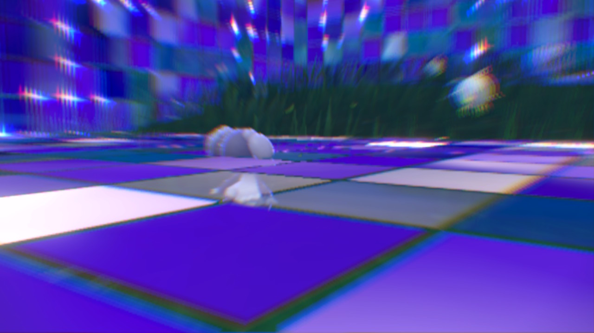

<!--
 * @Author: Ryuk
 * @Date: 2026-07-02 23:04:01
 * @LastEditors: Ryuk
 * @LastEditTime: 2026-08-16 10:30:00
 * @Description: TrickRoom English README
-->

# TrickRoom

<p align="center">
  
</p>

TrickRoom is a real-time voice chat room for Windows. One binary plays both roles —
it listens and dials as configured — carrying voice over UDP with TCP for signalling,
OpenAL for capture/playback and Opus for the codec. Every captured frame is enhanced
before it is encoded: the client runs a **configurable speech-enhancement chain**
(echo cancellation → noise suppression → automatic gain control → resampling) assembled
from the independent `libAE_*` algorithm libraries of
[soundproof](https://github.com/Ryuk17/soundproof), pulled in at configure time via
CMake `FetchContent` (no vendored copy in this repository).

> **Note:** Some features are still under development and the public interfaces
> may evolve. Contributions and pull requests are welcome!

> [中文文档](README_zh.md)

## Real-time Voice Pipeline

### Data path

```
 MIC — OpenAL capture, 48 kHz mono, 10 ms = 480 samples
   │
   ▼
 AEC ──▶ NS ──▶ AGC2 ──▶ SRC 48k→16k ──▶ Opus encode ──▶ UDP  (uplink)
   ▲
   │ far-end reference, 48 kHz, one frame per mic frame
   │
 SRC 16k→48k ◀── Opus decode ◀── UDP  (downlink)
   │
   ▼
 Playback — OpenAL
```

- Capture and the first four stages run at 48 kHz with 10 ms frames (480 samples);
  the uplink is 16 kHz mono Opus, i.e. 160 samples per 10 ms frame.
- The remote (far-end) signal is decoded at 16 kHz, upsampled to 48 kHz and queued in
  a 240 ms ring buffer. Each near-end frame is paired with the matching far-end frame,
  which is what makes the echo canceller work — the reference must stay in lockstep
  with capture.
- Capture, encode and playback live in [src/voice.cpp](src/voice.cpp); the pipeline
  itself is [src/audio.cpp](src/audio.cpp) (`Audio::process_pipeline`).

### Configuring the chain

The chain is **not hard-wired into the algorithm library** — it is composed by the
application out of independent libraries, so both the stages and their parameters are
configurable:

- **Pick the stages** — enable/disable any module at configure time with
  `-DBUILD_AE_<XXX>=OFF`, and link only the ones the app actually uses
  (`target_link_libraries(trickroom ...)` in [CMakeLists.txt](CMakeLists.txt)).
  Re-ordering or replacing a stage means editing `Audio::init_pipeline()` /
  `Audio::process_pipeline()`; nothing else in the room logic is algorithm-aware.
- **Tune at start-up** — each library takes its own init config (sample rate, channel
  count, AGC target gain, NS suppression level, …); TrickRoom currently sets these in
  `Audio::init_pipeline()` ([src/audio.cpp:406](src/audio.cpp#L406)) for
  AEC → NS → AGC2 → SRC.
- **Tune at runtime** — the modules with tunable parameters (AEC, AECM, AGC, AGC2, BF,
  NS, SRC, VAD) expose `SetParam` (incremental: only the fields you pass are overwritten)
  and `ResetParam` (restore defaults, then apply). Every module has `Reset` to rebuild
  internal state while keeping the configuration.
- **Inspect every stage** — uncomment `#define AUDIO_DEBUG_DUMP 1` in
  [src/audio.h:29](src/audio.h#L29) to dump each stage's input and the final output as
  WAVs under `dump/`.

### Algorithms available

The [soundproof](https://github.com/Ryuk17/soundproof) repository wraps audio-processing
algorithms as self-contained C libraries named `libAE_xxx` (`.a` / `.so` / `.dll`), where `xxx` is an
uppercase abbreviation of the algorithm. Every library exposes the same design pattern:
an opaque handle, an init config, frame-based `Process` calls, and unified error codes —
so any subset of them can be chained from plain C.

| Library      | Algorithm                        | Description                                          |
|--------------|----------------------------------|------------------------------------------------------|
| `libAE_VAD`  | Voice Activity Detection         | Standalone VAD, voice probability + threshold      |
| `libAE_SRC`  | Sample Rate Conversion           | Sinc-based resampler (push / pull)                 |
| `libAE_NS`   | Noise Suppression                | Noise suppressor (speech-preserving)               |
| `libAE_AGC`  | Automatic Gain Control (legacy)  | Analog / digital AGC                                 |
| `libAE_AGC2` | Automatic Gain Control 2         | Adaptive digital gain controller with RNN-VAD        |
| `libAE_AECM` | Acoustic Echo Cancellation Mobile| Low-resource echo canceller                          |
| `libAE_AEC`  | Acoustic Echo Cancellation (AEC3)| Full-band echo canceller (AVX2-optimized)            |
| `libAE_BF`   | Beamforming                      | Nonlinear beamformer                                 |
| `libAE_HS`   | Howling Suppression              | Goertzel tone detection + notch filters              |
| `libAE_IE`   | Intelligibility Enhancement      | Spectral intelligibility improvement                 |
| `libAE_TS`   | Transient Suppression            | Click / keyboard-noise suppression (WPD tree)        |
| `libAE_DR`   | Dereverberation                  | Doire 2017 EKF dereverberation, 16 kHz               |

## Repository Layout

```
TrickRoom/
├── README.md / README_zh.md      # Documentation
├── LICENSE                       # Apache License 2.0
├── CMakeLists.txt                # Super build: fetches soundproof + openal/opus, builds trickroom
├── assets/                       # Icons and static resources
├── bin/                          # Prebuilt binary + trickroom.ini
└── src/
    ├── audio.cpp / audio.h       # OpenAL capture/playback + the AEC→NS→AGC2→SRC pipeline
    ├── voice.cpp / voice.h       # Opus encode/decode, voice packet framing, UDP send/recv
    ├── trickroom.cpp / .h        # Room logic: listen/connect, peers, message routing
    ├── sock.cpp / queue.cpp      # Sockets and ring buffers
    ├── misc.cpp                  # Helpers
    └── winmain.cpp               # Win32 entry point
```

The audio-engine libraries (`libAE_xxx`) live in the separate
[soundproof](https://github.com/Ryuk17/soundproof) repository and are pulled in
by CMake `FetchContent` at configure time.

## Building and Running

### The chat client

Windows + MinGW. The super build fetches soundproof, OpenAL Soft and Opus, then
builds `bin/trickroom.exe`:

```bash
cmake -S . -B build -G "MinGW Makefiles" -DBUILD_TRICKROOM=ON
cmake --build build -j
```

`bin/trickroom.ini` selects the topology — the same binary listens and connects:

```ini
[trickroom]
listen=65534        ; TCP port this instance accepts on
connect=65535       ; TCP port it dials
localip=192.168.1.165   ; local address to bind
ip=192.168.1.166        ; peer address to dial
udp_listen=65532    ; voice (UDP) port it binds
udp_connect=65533   ; voice (UDP) port it dials to
capture=1           ; enable microphone capture
```

### The algorithm libraries

`-DBUILD_AUDIO_ENGINE=ON` (default) fetches soundproof from git
(`GIT_TAG master`) and builds all `libAE_xxx` targets as part of the same build.
All libraries are enabled by default; disable individual ones with
`-DBUILD_AE_<XXX>=OFF`, e.g. `-DBUILD_AE_DR=OFF` (available: `BUILD_AE_VAD`,
`BUILD_AE_SRC`, `BUILD_AE_NS`, `BUILD_AE_AGC`, `BUILD_AE_AGC2`, `BUILD_AE_AECM`,
`BUILD_AE_AEC`, `BUILD_AE_BF`, `BUILD_AE_HS`, `BUILD_AE_IE`, `BUILD_AE_TS`,
`BUILD_AE_DR`).

To use a local soundproof checkout instead of the git fetch (recommended while
developing the engine — local edits take effect on the next build):

```bash
cmake -S . -B build -G "MinGW Makefiles" -DBUILD_TRICKROOM=ON \
      -DFETCHCONTENT_SOURCE_DIR_SOUNDPROOF=F:/share/soundproof
```

The engine can also be built standalone inside its own repository — see the
soundproof README. Soundproof fetches its own dependencies (abseil-cpp,
neon-fft, pffft, eigen) as URL tarballs with SHA256 checksums; it requires
CMake ≥ 3.16 and a C++20 compiler.

Outputs (in the soundproof source/build tree):

- Libraries: `lib/libAE_*.a`
- Test executables: `bin/test_ae_*.exe`

## Testing

Two test layers live in the soundproof repository:

- `soundproof/core/tests/test_*.cc` — reference tests that call the algorithm
  classes directly (the ground truth for behavior).
- `tests/test_ae_*.cc` — interface tests that link against `libAE_xxx` and
  exercise the C API: normal flow, `Reset`, and error cases.

The interface tests are registered with CTest by the super build
(`ctest --test-dir build`), or run standalone from the soundproof root
(test vectors are read from `assets/`):

```bash
./bin/test_ae_vad.exe
```

Consistency is enforced: interface output must be **byte-identical** to the
reference output produced by the corresponding internal test
(see `assets/*_out.wav`).

## Cross-Platform

The audio engine is designed for Windows, desktop Linux and embedded Linux:

- No OS-specific code in the public interfaces.
- Toolchain files for `x86_64-windows` (MinGW), `aarch64-linux-gnu` and
  `arm-linux-gnueabihf` (NEON) under `toolchains/` in the soundproof repository.
- AVX2 intrinsics are used in dedicated per-file implementations on x86-64
  targets (e.g. `sinc_resampler_avx2.cc`, AEC3 vector math).

## License

TrickRoom itself is released under the [Apache License 2.0](LICENSE).

The project depends on third-party components, and their licenses apply to the
respective portions of this repository as well. Please review the license of
every dependency before distributing or embedding:

| Component                                          | License                                                          |
|----------------------------------------------------|------------------------------------------------------------------|
| This repository (TrickRoom)                        | Apache License 2.0                                               |
| abseil-cpp                                         | Apache License 2.0                                               |
| NE10 / neon-fft                                    | Apache License 2.0                                               |
| WebRTC (`core`, `dsp`) — soundproof                | BSD 3-Clause; a few routines are public domain (see `soundproof/dsp/LICENSE`) |
| pffft                                              | BSD-like permissive license                                      |
| Eigen                                              | MPL 2.0 (a few files under BSD or other MPL2-compatible terms)   |
| Voicebox v_spendred (libAE_DR reference)           | See the upstream [Voicebox](https://github.com/ImperialCollegeLondon/sap-voicebox) project |
| OpenAL Soft                                        | LGPL 2.0 or later                                                |
| Opus                                               | BSD 3-Clause                                                     |

> This overview is provided for convenience only and does not constitute legal advice.

## Reference

1. <https://github.com/akw0088/zoomy> — the chat-room code base TrickRoom builds on
2. <https://webrtc.googlesource.com/src/> — WebRTC, source of most wrapped algorithms
3. <https://github.com/ImperialCollegeLondon/sap-voicebox> — MATLAB Voicebox toolbox
   (v_spendred), the reference for libAE_DR
4. C. S. J. Doire et al., "Single-channel online enhancement of speech corrupted by
   reverberation and noise", IEEE Trans. ASLP 25(3), 2017 (libAE_DR)
