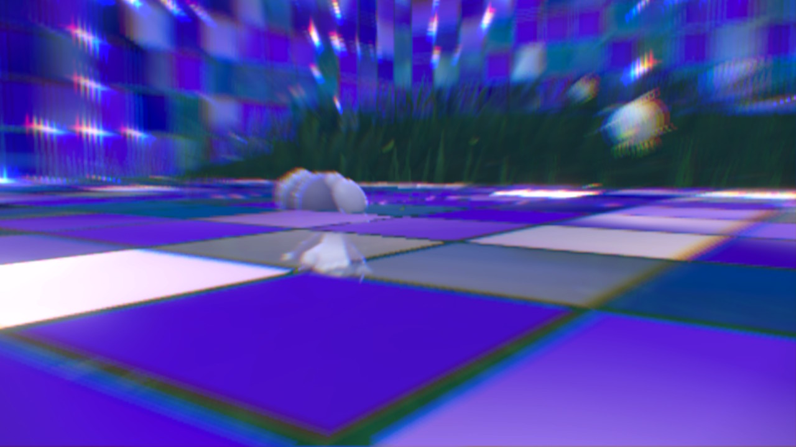

<!--
 * @Author: Ryuk
 * @Date: 2026-08-16 10:30:00
 * @LastEditors: Ryuk
 * @LastEditTime: 2026-08-16 10:30:00
 * @Description: TrickRoom Chinese README
-->

# TrickRoom

<p align="center">
  
</p>

TrickRoom 是一个 Windows 实时语音聊天室。同一个可执行文件按配置既监听又拨号，
语音走 UDP、信令走 TCP，采集/播放用 OpenAL，编解码用 Opus。每一帧采集数据在编码前
都要经过**可配置的语音增强链路**（回声消除 → 降噪 → 自动增益 → 重采样），
链路由 [soundproof](https://github.com/Ryuk17/soundproof) 提供的独立 `libAE_*` 算法库
按需组合而成，在 configure 阶段通过 CMake `FetchContent` 拉取（本仓库不再内置副本）。

> **说明：** 部分功能仍在开发中，公开接口可能会调整。欢迎提交 PR 与贡献！

> [English Documentation](README.md)

## 实时语音链路

### 数据流

```
 MIC —— OpenAL 采集，48 kHz 单声道，10 ms = 480 样本
   │
   ▼
 AEC ──▶ NS ──▶ AGC2 ──▶ SRC 48k→16k ──▶ Opus 编码 ──▶ UDP  （上行）
   ▲
   │ 远端参考信号，48 kHz，每个麦克风帧对应一帧
   │
 SRC 16k→48k ◀── Opus 解码 ◀── UDP  （下行）
   │
   ▼
 播放 —— OpenAL
```

- 采集与前四级均按 48 kHz / 10 ms 帧（480 样本）处理；上行是 16 kHz 单声道 Opus，
  即每 10 ms 帧 160 样本。
- 远端（far-end）信号以 16 kHz 解码、上采样到 48 kHz 后进入 240 ms 环形缓冲；
  每个近端帧与对应的远端帧配对送入 AEC 作参考——参考信号必须与采集严格同步，
  回声消除才有效。
- 采集、编码与播放位于 [src/voice.cpp](src/voice.cpp)；链路本身在
  [src/audio.cpp](src/audio.cpp)（`Audio::process_pipeline`）。

### 链路可配置

链路**不固化在算法库内部**，而是由应用用一个个独立库拼出来，因此链路组成与参数都可配置：

- **选算法** —— configure 阶段用 `-DBUILD_AE_<XXX>=OFF` 开关任意模块，并且只链接应用
  真正用到的目标（[CMakeLists.txt](CMakeLists.txt) 中的 `target_link_libraries(trickroom ...)`）。
  增删或调换一级算法，只需改 `Audio::init_pipeline()` / `Audio::process_pipeline()`；
  聊天室其余逻辑不感知具体算法。
- **启动时调参** —— 每个库有自己的初始化配置（采样率、声道数、AGC 目标增益、
  降噪强度等）；TrickRoom 当前在 `Audio::init_pipeline()`
  （[src/audio.cpp:406](src/audio.cpp#L406)）中为 AEC → NS → AGC2 → SRC 设值。
- **运行时调参** —— 带可调参数的模块（AEC、AECM、AGC、AGC2、BF、NS、SRC、VAD）提供
  `SetParam`（增量：只覆盖传入字段）与 `ResetParam`（先回默认值再应用）；所有模块都有
  `Reset`，在保留配置的前提下重建内部状态。
- **逐级排查** —— 打开 [src/audio.h:29](src/audio.h#L29) 的 `#define AUDIO_DEBUG_DUMP 1`，
  即可把每一级的输入和最终输出 dump 成 WAV 到 `dump/`。

### 已封装的库

[soundproof](https://github.com/Ryuk17/soundproof) 将音频处理算法封装为独立的 C 库，
命名为 `libAE_xxx`（`.a` / `.so` / `.dll`），其中 `xxx` 为算法的大写缩写。
所有库遵循同一设计模式：不透明句柄 + 初始化配置 + 按帧 `Process` 处理 + 统一错误码，
因此任意子集都可以直接用纯 C 串联。

| 库名         | 算法                     | 说明                                       |
|--------------|--------------------------|--------------------------------------------|
| `libAE_VAD`  | 语音活动检测 (VAD)       | 独立 VAD，语音概率 + 阈值判定              |
| `libAE_SRC`  | 采样率转换               | 基于 sinc 的重采样器（push / pull）        |
| `libAE_NS`   | 降噪 (NS)                | 降噪器（保留语音）                         |
| `libAE_AGC`  | 自动增益控制 (AGC 旧版)  | 模拟 / 数字 AGC                            |
| `libAE_AGC2` | 自动增益控制 2 (AGC2)    | 带 RNN-VAD 的自适应数字增益控制器          |
| `libAE_AECM` | 回声消除 (AECM 移动版)   | 低资源占用回声消除器                       |
| `libAE_AEC`  | 回声消除 (AEC3)          | 全频带回声消除器（AVX2 优化）              |
| `libAE_BF`   | 波束成形 (BF)            | 非线性波束成形器                           |
| `libAE_HS`   | 啸叫抑制 (HS)            | Goertzel 音调检测 + 陷波滤波器             |
| `libAE_IE`   | 可懂度增强 (IE)          | 频谱可懂度改善                             |
| `libAE_TS`   | 瞬态抑制 (TS)            | 键盘敲击 / 瞬态噪声抑制（WPD 树）          |
| `libAE_DR`   | 去混响 (DR)              | Doire 2017 EKF 去混响，仅支持 16 kHz       |

## 目录结构

```
TrickRoom/
├── README.md / README_zh.md      # 文档
├── LICENSE                       # Apache License 2.0
├── CMakeLists.txt                # super build：拉取 soundproof + openal/opus，编译 trickroom
├── assets/                       # 图标等静态资源
├── bin/                          # 预编译程序 + trickroom.ini
└── src/
    ├── audio.cpp / audio.h       # OpenAL 采集/播放 + AEC→NS→AGC2→SRC 链路
    ├── voice.cpp / voice.h       # Opus 编解码、语音包封装、UDP 收发
    ├── trickroom.cpp / .h        # 房间逻辑：监听/拨号、对端、消息路由
    ├── sock.cpp / queue.cpp      # socket 与环形缓冲区
    ├── misc.cpp                  # 辅助函数
    └── winmain.cpp               # Win32 入口
```

音频算法库（`libAE_xxx`）位于独立的
[soundproof](https://github.com/Ryuk17/soundproof) 仓库，由 CMake `FetchContent`
在 configure 阶段拉取。

## 编译与运行

### 聊天室程序

Windows + MinGW。super build 会拉取 soundproof、OpenAL Soft 与 Opus，
然后编译出 `bin/trickroom.exe`：

```bash
cmake -S . -B build -G "MinGW Makefiles" -DBUILD_TRICKROOM=ON
cmake --build build -j
```

`bin/trickroom.ini` 决定拓扑——同一个程序既监听也拨号：

```ini
[trickroom]
listen=65534        ; 本端监听的 TCP 端口
connect=65535       ; 本端拨号的 TCP 端口
localip=192.168.1.165   ; 本端绑定地址
ip=192.168.1.166        ; 对端地址
udp_listen=65532    ; 本端绑定的语音（UDP）端口
udp_connect=65533   ; 本端拨号的语音（UDP）端口
capture=1           ; 打开麦克风采集
```

### 算法库

`-DBUILD_AUDIO_ENGINE=ON`（默认）会从 git 拉取 soundproof（`GIT_TAG master`），
并在同一次编译中构建全部 `libAE_xxx` 目标。默认全部库开启，可用
`-DBUILD_AE_<XXX>=OFF` 单独关闭（如 `-DBUILD_AE_DR=OFF`；可用选项：
`BUILD_AE_VAD`、`BUILD_AE_SRC`、`BUILD_AE_NS`、`BUILD_AE_AGC`、`BUILD_AE_AGC2`、
`BUILD_AE_AECM`、`BUILD_AE_AEC`、`BUILD_AE_BF`、`BUILD_AE_HS`、`BUILD_AE_IE`、
`BUILD_AE_TS`、`BUILD_AE_DR`）。

开发引擎时可改用本地 soundproof 检出（推荐——本地改动下次编译即生效）：

```bash
cmake -S . -B build -G "MinGW Makefiles" -DBUILD_TRICKROOM=ON \
      -DFETCHCONTENT_SOURCE_DIR_SOUNDPROOF=F:/share/soundproof
```

引擎也可以在 soundproof 仓库内独立编译，参见其 README。soundproof 自行拉取
依赖（abseil-cpp、neon-fft、pffft、eigen，均为 URL tarball + SHA256 校验），
需要 CMake ≥ 3.16 与支持 C++20 的编译器。

产物（位于 soundproof 的源码/构建树内）：

- 库文件：`lib/libAE_*.a`
- 测试程序：`bin/test_ae_*.exe`

## 测试

测试分两层，均位于 soundproof 仓库：

- `soundproof/core/tests/test_*.cc` —— 直接调用算法类的内部参考测试（行为基准）。
- `tests/test_ae_*.cc` —— 链接 `libAE_xxx` 的接口测试，覆盖正常流程、`Reset` 与错误用例。

接口测试由 super build 注册到 CTest（`ctest --test-dir build`），
也可在 soundproof 根目录独立运行（测试数据从 `assets/` 读取）：

```bash
./bin/test_ae_vad.exe
```

一致性要求：接口输出必须与对应内部测试的参考输出**逐字节一致**
（见 `assets/*_out.wav`）。

## 跨平台

音频引擎面向 Windows、桌面 Linux 与嵌入式 Linux：

- 对外接口不含平台相关代码。
- soundproof 仓库的 `toolchains/` 提供 `x86_64-windows`（MinGW）、
  `aarch64-linux-gnu`、`arm-linux-gnueabihf`（NEON）工具链文件。
- AVX2 指令在 x86-64 平台以独立按文件实现的方式使用
  （如 `sinc_resampler_avx2.cc`、AEC3 向量运算）。

## 许可证

TrickRoom 本体以 [Apache License 2.0](LICENSE) 发布。

本项目依赖第三方组件，其许可证同样适用于仓库中对应的部分。在分发或嵌入前，
请逐一审阅各依赖的许可证：

| 组件                                              | 许可证                                                            |
|---------------------------------------------------|-------------------------------------------------------------------|
| 本仓库（TrickRoom）                                | Apache License 2.0                                                |
| abseil-cpp                                        | Apache License 2.0                                                |
| NE10 / neon-fft                                   | Apache License 2.0                                                |
| WebRTC（`core`、`dsp`）—— soundproof            | BSD 3-Clause；少量例程为公共领域（见 soundproof 的 `soundproof/dsp/LICENSE`） |
| pffft                                             | BSD 类宽松许可证                                                  |
| Eigen                                             | MPL 2.0（少量文件为 BSD 或其他与 MPL2 兼容的条款）                |
| Voicebox v_spendred（libAE_DR 参考实现）           | 参见上游 [Voicebox](https://github.com/ImperialCollegeLondon/sap-voicebox) 项目 |
| OpenAL Soft                                        | LGPL 2.0 或更高版本                                                |
| Opus                                               | BSD 3-Clause                                                       |

> 以上信息仅为方便说明，不构成法律建议。

## 参考资料

1. <https://github.com/akw0088/zoomy> —— TrickRoom 所基于的聊天室代码库
2. <https://webrtc.googlesource.com/src/> —— WebRTC，多数封装算法的来源
3. <https://github.com/ImperialCollegeLondon/sap-voicebox> —— MATLAB Voicebox 工具箱
   （v_spendred），libAE_DR 的参考实现
4. C. S. J. Doire et al., "Single-channel online enhancement of speech corrupted by
   reverberation and noise", IEEE Trans. ASLP 25(3), 2017（libAE_DR）
